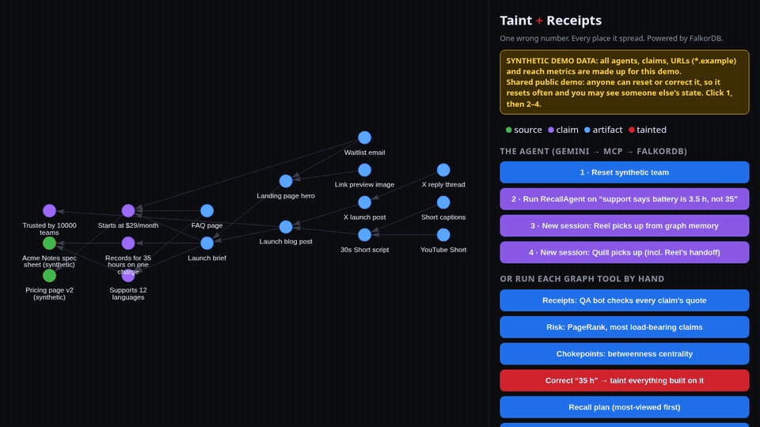

# Taint + Receipts: a recall system for published content

> One wrong number. Every post, Short, email and link-preview image it reached, who owns each one, and roughly how many people saw it. An agent fixes the most-viewed first, and the team picks the work up next session from graph memory.



**▶ Demo video (1:51):** https://youtu.be/Tb0cxya0vOk

> **Try it in 60 seconds:** open **https://taint-receipts.lumegridai.workers.dev**
> 1. Click **1 · Reset**.
> 2. Click **2 · Run RecallAgent**. Gemini decides each step and calls graph tools over MCP. Watch every tool call light up the path it followed, then read the recall memo it writes for each owner.
> 3. Click **3 · New session: Reel**, then **4 · New session: Quill**. Each agent starts with no memory except the graph. It finds its redo tasks and memos, fixes what's in its role, hands the rest off, and logs what it did.
>
> All data is synthetic. Point any MCP client at `POST https://taint-receipts.lumegridai.workers.dev/mcp` to use the read-only graph tools yourself.

Content teams (human or AI agents) ship posts, Shorts, emails, landing pages and link-preview images built on top of each other. When a researcher misreads "3.5 hours" as "35 hours", the number spreads into everything downstream, and some of it is already live. **Taint + Receipts** stores every claim, source quote and published artifact in **FalkorDB**. The **RecallAgent** treats a correction like a product recall:

1. **Receipts.** It checks that each claim's number actually appears in the source quote it cites, and it refutes claims with no source.
2. **Risk (PageRank).** `claim_risk` runs `algo.pageRank` over `DERIVED_FROM` and adds up the published reach downstream of each claim, so the agent knows how load-bearing the bad claim is. `chokepoints` runs `algo.betweenness` to find the artifacts most dependency paths run through.
3. **Taint.** Correcting a claim runs a bounded `DERIVED_FROM*1..10` traversal that marks every downstream artifact as tainted, with its hop distance. The agent may only correct a claim to a value that one of its cited sources actually contains, so a correction needs a receipt too.
4. **Recall plan.** Every tainted *published* item comes back with its owner, live URL and estimated reach, most-viewed first.
5. **Why (shortestPath).** "Why is the Short wrong?" returns the shortest path Short → script → blog → brief → claim → the exact source quote.
6. **Re-queue + memos.** Each tainted artifact becomes a redo task (`redo-<artifact id>`) owned by its producer. The agent writes one recall memo per owner, stores it in the graph linked to their tasks, and logs an episode.
7. **Memory across sessions.** In a new session an agent calls `start_session` and gets back its open tasks, handoff notes, memos and earlier episodes, all from the graph. It completes its own work and hands the rest off. The graph refuses handoff ping-pong and handing a task to yourself.
8. **Trust ledger.** Each agent's share of refuted or corrected claims, computed from the graph.

## The agent loop
```
Gemini (gemini-3.5-flash-lite) ──function calls──▶ MCP tools/call ──▶ Cypher on FalkorDB
        ▲                                                  │
        └──────────── tool results (graph rows) ◀──────────┘
```
- **Locally:** `python -m teamgraph.agent recall "..."` runs Gemini against the real stdio MCP server (`teamgraph.mcp_server`). Every tool call is an MCP `tools/call`.
- **Live demo:** the Cloudflare Worker serves the same tool set as a stateless MCP JSON-RPC endpoint (`/mcp`, read-only for the public). Its agent calls those tools through the same `rpc()` handler.
- **Guardrails, enforced in code:** each mode gets only its own tools, and session agents can act only as themselves. Corrections need a source receipt. Tool calls are capped per run, inputs are schema-validated and length-capped, and correction text is treated as untrusted data. LLM spend is priced and capped (`LLM_CAP_USD`, default $0.50 total). After that, or during the 20-second cooldown between live runs, the demo **replays a recorded Gemini run**: the same tool calls, executed live on FalkorDB, and labelled as a replay in the UI. See `docs/SECURITY-REVIEW.md`.

## Scale: measured on embedded FalkorDB (FalkorDBLite, this box)
`python -m teamgraph.scale 1000 25` seeds 1,000 claims and 25,000 synthetic published artifacts with chains up to 10 hops deep, then times the cascade query.

| Graph | Nodes | Edges | Cascade query p50 / max | Correct + recall plan |
|---|---|---|---|---|
| 200 claims × 25 | 5,204 | 10,219 | 0.50 ms / 3.2 ms | 4.1 ms |
| 1,000 claims × 25 | 26,004 | 51,099 | 0.55 ms / 7.5 ms | 14.9 ms |

Numbers are from one run on a shared Linux box (14 Oct 2026). The demo video's terminal panel shows a later run of the same command (p50 0.62 ms, max 9.01 ms, correct + recall 14.93 ms). Your hardware will differ; rerun the script to check.

## Tracks entered
- **Agents That Act on Connected Data (primary):** a Gemini agent picks MCP graph tools (multi-hop traversal, PageRank, betweenness, shortestPath), acts on what the graph shows (correct, taint, re-queue, memo) and explains each answer with a path.
- **Agent Memory and Coordination:** episodic memory (episodes per session), semantic memory (facts), procedural memory (procedures), shared state and handoffs between agents. Session 2 agents start from graph memory alone; see buttons 3 and 4 and `tests/test_agent.py`.
- **Company Brain (narrow scope, stated honestly):** we don't ingest docs, tickets or chats. Our "brain" is narrower: one graph of what a company has *publicly claimed*, which document backs each claim, who made it, and who owns each fix, with every answer traced to its source quote.

## Setup (local)
```bash
python3 -m venv .venv && .venv/bin/pip install -e ".[dev]"
.venv/bin/python -m pytest -q          # tests incl. MCP over stdio, graph algorithms, invariants, scripted agent runs
.venv/bin/python -m teamgraph.scale 1000 25   # seed ~26k nodes and time the cascade
.venv/bin/python -m teamgraph.web      # demo UI at http://localhost:8787 (graph tool buttons; the agent runs from the CLI)
.venv/bin/python -m teamgraph.mcp_server   # MCP server (stdio) for agents
GEMINI_API_KEY=... TEAMGRAPH_GRAPH=demo .venv/bin/python -m teamgraph.agent --seed recall "Support says battery life is 3.5 hours, not 35"
GEMINI_API_KEY=... TEAMGRAPH_GRAPH=demo .venv/bin/python -m teamgraph.agent session Reel
```
- With no `FALKORDB_URL` set, it uses embedded FalkorDB (FalkorDBLite) at `$TEAMGRAPH_DB` (default `/tmp/teamgraph.db`).
- To use Docker or FalkorDB Cloud instead, run `docker run -p 6379:6379 falkordb/falkordb` and set `FALKORDB_URL=redis://localhost:6379` (or your Cloud URL).
- One agent run costs about 20k input tokens on `gemini-3.5-flash-lite`, roughly $0.01.

### Correctness is enforced by checks, not by convention
- **One query module.** `teamgraph/cypher.py` (Python) and `worker/src/cypher.js` (Worker) are the only code that talks to FalkorDB. Queries are constants registered at import, every value is a parameter, and `run()` refuses anything unregistered. `tests/test_invariants.py` and `worker/test/invariants.test.mjs` fail the build if any other file calls `.query(` or builds Cypher from strings.
- **Validated inputs:** pydantic models and constrained types (`teamgraph/models.py`) on every MCP tool and the local UI, and schema validation on every Worker tool call.
- **CI** (`.github/workflows/ci.yml`) runs on every push and PR: ruff lint and format, `mypy --strict`, pytest, Worker tests, a gitleaks scan over the full history, pip-audit, npm audit, and a Worker bundle check.

## Graph data model
```
(:Agent {name, role})-[:ASSERTED]->(:Claim {id, text, value, status: ok|refuted|corrected, reason, fixed_value})
(:Claim)-[:CITES {quote}]->(:Source {id, title, url, text})
(:Agent)-[:PRODUCED]->(:Artifact {id, kind, title, status: live|tainted, url, reach, owner})
(:Artifact)-[:DERIVED_FROM]->(:Artifact | :Claim)
(:Agent)-[:OWNS]->(:Task {id: 'redo-<artifact id>', artifact, title, status})
# shared-memory layer (teamgraph/graph.py)
(:Agent)-[:EXPERIENCED]->(:Episode)-[:ABOUT]->(:Task)
(:Concept)-[:SUBJECT_OF]->(:Fact {predicate})-[:OBJECT]->(:Concept); (:Fact)-[:CITES]->(:Source)
(:Procedure)-[:STEP {order}]->(:Step)
(:Agent)-[:GAVE]->(:Handoff)-[:TO]->(:Agent); (:Handoff)-[:FOR]->(:Task)
(:Agent)-[:DECIDED]->(:Decision)-[:BASED_ON]->(:Source); (:Decision)-[:SUPERSEDES]->(:Decision)
(:Agent)-[:RECEIVED]->(:Memo {text, author})-[:COVERS]->(:Task)
```

## Core Cypher
Graph algorithms as agent tools (FalkorDB `algo.*` procedures and `shortestPath`):
```cypher
// claim_risk: PageRank over the provenance graph + the published reach downstream of each claim
CALL algo.pageRank(NULL, 'DERIVED_FROM') YIELD node, score
WITH node, score WHERE node:Claim
OPTIONAL MATCH (x:Artifact)-[:DERIVED_FROM*1..10]->(node)
WITH node, score, collect(DISTINCT x) AS xs
RETURN node.id, score, size(xs), reduce(s = 0, a IN xs | s + coalesce(a.reach, 0)) AS exposed ORDER BY exposed DESC
// chokepoints: betweenness centrality, which artifacts most dependency paths run through
CALL algo.betweenness({relationshipTypes: ['DERIVED_FROM']}) YIELD node, score
// why_shortest: the shortest provenance path from a published item back to the bad claim
MATCH (x:Artifact {id:$id}), (c:Claim) WHERE c.status IN ['corrected','refuted']
WITH x, c, shortestPath((x)-[:DERIVED_FROM*1..10]->(c)) AS p WHERE p IS NOT NULL
OPTIONAL MATCH (c)-[r:CITES]->(s:Source) RETURN [n IN nodes(p) | n.id], c.reason, s.title, r.quote
```
Taint cascade (correction blast radius):
```cypher
MATCH (bad:Claim {id:$id}) SET bad.status='corrected', bad.fixed_value=$value, bad.reason=$reason
WITH bad MATCH p=(x:Artifact)-[:DERIVED_FROM*1..10]->(bad)
SET x.status='tainted' RETURN DISTINCT x.id, x.kind, x.title, length(p) ORDER BY length(p)
```
Why is this artifact wrong (provenance path to the source quote):
```cypher
MATCH p=(x:Artifact {id:$id})-[:DERIVED_FROM*1..10]->(c:Claim) WHERE c.status IN ['corrected','refuted']
OPTIONAL MATCH (c)-[r:CITES]->(s:Source)
RETURN [n IN nodes(p) | coalesce(n.title, n.text)], c.reason, s.title, r.quote
```
Receipts input (each claim with its cited quote; the number check runs in `taint.py`):
```cypher
MATCH (a:Agent)-[:ASSERTED]->(c:Claim) WHERE c.status='ok'
OPTIONAL MATCH (c)-[r:CITES]->(s:Source) RETURN c.id, c.text, c.value, a.name, s.id, s.text, r.quote
```
Recall plan, most-viewed first:
```cypher
MATCH (x:Artifact {status:'tainted'})<-[:PRODUCED]-(a:Agent)
RETURN x.id, x.kind, x.title, coalesce(x.reach,0), x.url, coalesce(x.owner, a.name)
ORDER BY coalesce(x.reach,0) DESC
```
Re-queue to producer (stable task id; never re-assigns a task that was handed off):
```cypher
MATCH (x:Artifact {status:'tainted'})<-[:PRODUCED]-(a:Agent)
MERGE (t:Task {id:'redo-' + x.id}) ON CREATE SET t.artifact=x.id, t.status='open', t.title='Redo ' + x.title
WITH x, a, t OPTIONAL MATCH (t)<-[:OWNS]-(o:Agent)
WITH x, a, t, count(o) AS owners
FOREACH (_ IN CASE WHEN owners = 0 THEN [1] ELSE [] END | MERGE (a)-[:OWNS]->(t))
RETURN a.name, x.title, t.id ORDER BY t.id
```
Trust ledger:
```cypher
MATCH (a:Agent) OPTIONAL MATCH (a)-[:ASSERTED]->(c:Claim)
WITH a, count(c) AS total, sum(CASE WHEN c.status IN ['refuted','corrected'] THEN 1 ELSE 0 END) AS bad
RETURN a.name, total, bad, CASE WHEN total=0 THEN null ELSE toFloat(total-bad)/total END AS trust
```
The procedure-driven next step, episodic and semantic recall, and handoff queries are in `teamgraph/graph.py` (dict `Q`).

## Live demo
**https://taint-receipts.lumegridai.workers.dev** is a shared public demo with synthetic data. One sandbox graph (`taint_demo`) has no login and no per-visitor isolation, so anyone's actions affect everyone. Reset has a 15-second cooldown, each visitor is rate-limited, and the LLM budget is capped. Run it locally for a private copy.

## Architecture
```
browser (web/, vis-network graph view + agent trace + text equivalent)
   │  POST /api/{reset,agent,session,receipts,risk,chokepoints,correct,recall,why,requeue,briefing,trust}   (JSON only)
   ▼
Cloudflare Worker (worker/src) ── rate limits, cooldowns, LLM budget (meta graph) ── Gemini API
   │  tools.js: MCP tool registry + rpc()   ·   /mcp: public read-only MCP (JSON-RPC)
   ▼  cypher.js: the only query path ── RESP over TCP (cloudflare:sockets) ──▶ FalkorDB Cloud

agents ── MCP stdio (teamgraph/mcp_server.py) ──▶ teamgraph/cypher.py ──▶ FalkorDB / FalkorDBLite
```

## Deploy
See `worker/DEPLOY.md`: `cd worker && npm i && npx wrangler secret put FALKORDB_URL && npx wrangler deploy`. Secrets are `FALKORDB_URL` and `GEMINI_API_KEY` (set with `npx wrangler secret put`); neither is ever committed.

## Demo video
**v2 (current, 1:51):** https://youtu.be/Tb0cxya0vOk. The Gemini agent working over MCP, graph algorithms, memory across sessions, and the guardrails, recorded on the live production demo.

The UI clips are real screen recordings of the production demo: live Gemini runs against FalkorDB Cloud, captured by `video/v2/capture-v2.mjs`. Rendered MP4s and the raw capture aren't committed (size). The voice segments (`video/v2/audio/`, Gemini TTS), narration text (`video/v2/lines.json`), captions and timing marks (`video/rm/src/v2/`), and the Remotion composition (`DemoV2`) are committed.

Earlier v1 videos (before the agent, graph algorithms and cross-session memory): [16:9](https://youtu.be/5tIi7fYVGXE), [9:16 Short](https://youtube.com/shorts/ugadWb9bxSA). `video/REBUILD.md` covers re-rendering v1 from its committed inputs.

## Related work, and how this differs
This isn't the first system to propagate corrections through derived claims. We checked these on 14 Oct 2026:
- **Memorant** (github.com/tier4research/memorant): agent memory with a `correct_claim()` that flags everything derived from a claim for review. Its unit is the memory or claim inside an agent's knowledge store.
- **Lattice** (github.com/thunderstornX/lattice): a signed claim DAG with agent attribution and a "revocation waterfall" when a claim is revoked. Its strength is cryptographic provenance.
- Research on provenance-native audit (including retraction propagation), plus claim-to-source checkers such as ProvenanceGuard and TRACER.

What we focus on that we didn't see in those: **shipped artifacts across media** (posts, Shorts, captions, emails, link-preview images) as first-class nodes, each with an **owner, live URL and estimated reach**, and a **recall plan ordered by audience size**. We also run it on FalkorDB at tens of thousands of nodes and expose it over MCP. If you need signed provenance, Lattice does more there. If you need agent memory correction, look at Memorant.

All demo data is synthetic, and reach figures are made-up estimates: a fictional product, "Acme Notes", and fictional agents Scout, Quill, Reel and Lens.

## AI tool use disclosure
- **Code, docs and video pipeline:** written by AI agents. The build agent was LumeGrid's Grok Bot agent, working on a Linux box at the direction of LumeGrid's founder, Matt Brady, who chose the hackathon, approved the scope and controls publication. A second AI agent (Pika) did QA review of the code, bundle and videos. We are not claiming a line-by-line human code review.
- **Voiceover:** Google Gemini TTS (`gemini-3.8-flash-tts`, prebuilt voice Puck), composed with Remotion and loudness-normalized to -14 LUFS. Evidence in this repo: `video/tts.py` (the exact request), `video/lines.json` (the text that was voiced), the `video/audio/*.wav` segments, and `video/tts-calls.public.jsonl`, a sanitized copy of our local TTS call log that keeps only the UTC time and scene id of each call (no keys, request bodies or responses). The raw local log stays out of the repo.
- **Demo data:** every agent, claim, source, URL (`*.example`) and reach number in the demo is synthetic. Nothing in the demo is customer or real-campaign data.
- **The product:** the RecallAgent and the session agents use Gemini (`gemini-3.5-flash-lite`) to choose tools. Receipts, taint, risk, recall, why-paths and trust are deterministic Cypher over FalkorDB.

## License
MIT — see `LICENSE`.

## Build timing
Built new during Graph Hacks (build window opened Oct 14, 2026 12:31 PM MDT / 18:31 UTC). The first file (`.venv`) was created at 2:00 PM MDT and the first commit is 2:06:57 PM MDT (20:06:57 UTC) in our original local history. This public repo is a clean export of that history made at 10:55 PM MDT, so its first commit shows 22:55. `docs/HISTORY.md` maps the original commits to the export and lists the evidence and its limits.
